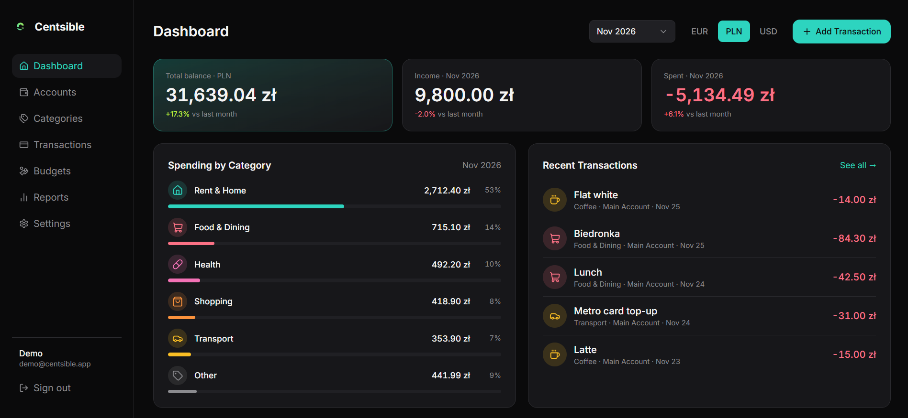
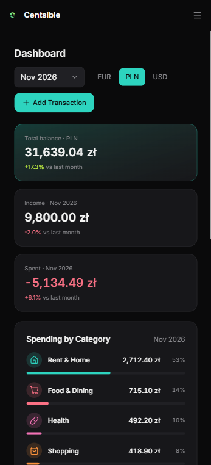
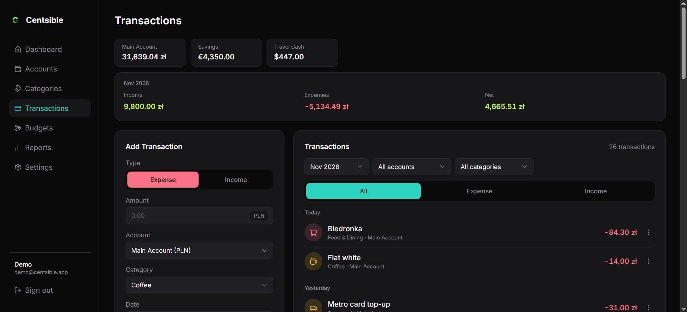
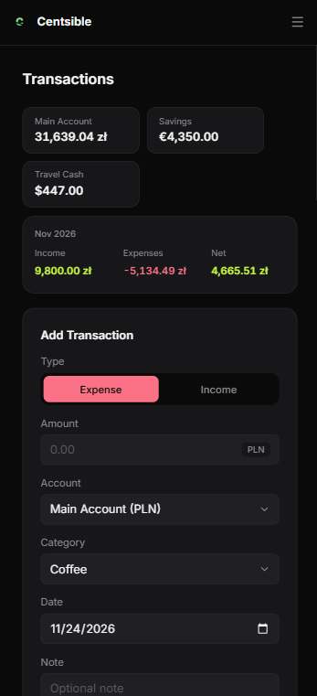
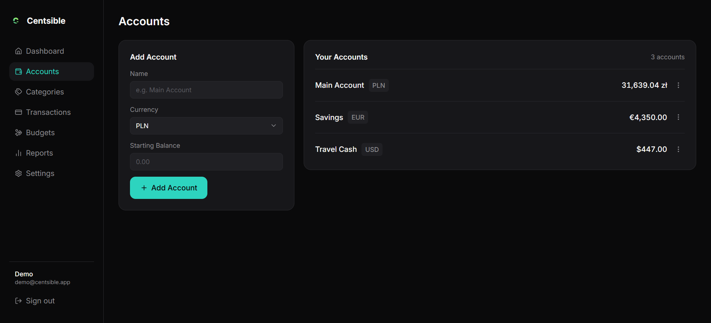
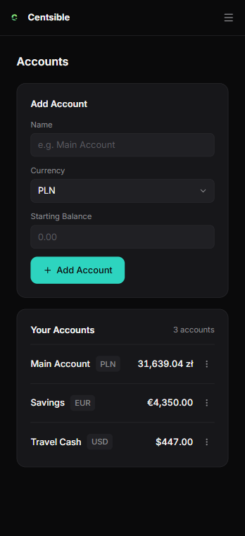
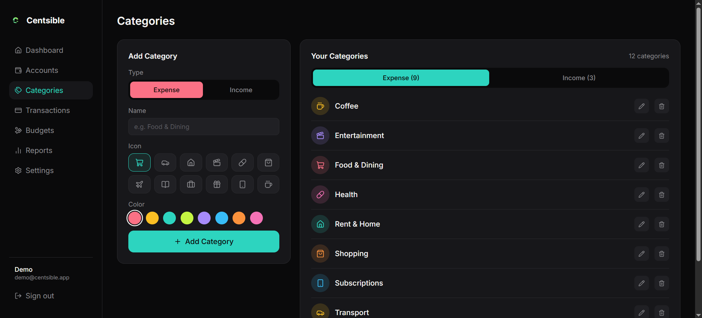
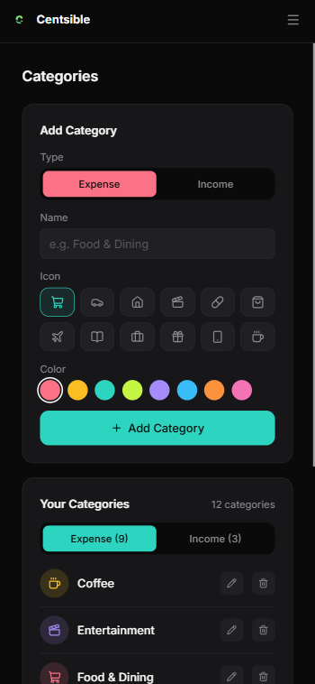

# Centsible

Budget tracker and planner with AI-powered analytics. Work in progress.

**[Live demo](https://centsible-budget.vercel.app/)** · [API repository](https://github.com/volha-codes/centsible-api)

 

 

 

 

## Try it

Open the live demo and press **Try the demo** on the sign-in page to look around
without signing up. It signs you in to a shared demo account filled with sample data:
three accounts in PLN, EUR and USD, twelve categories and about sixty transactions
over the last four months. The dates are generated relative to today, and the data is
reset every time the button is pressed, so changes you make do not last.
After signing in you land on the dashboard.

## What it does

You can sign up, sign in and sign out. Each user manages their own data:

- **Dashboard** for a chosen month and currency: the total balance, income and
  spending with the change from the previous month, spending by category, the latest
  transactions, and a chart of income against expenses over the last six months.
  Hovering a bar shows which categories it is made of.
- **Accounts** with a currency and a starting balance. The current balance is
  calculated from the starting balance and the account's transactions.
- **Categories**, either income or expense, with an icon and a colour, listed under
  Expense and Income tabs.
- **Transactions**: add, edit and delete them. Each belongs to an account and a
  category. The list is grouped by day and can be filtered by month, account, category
  and type. Above it, a strip shows each account's current balance, and a table shows
  income, expenses and the net result for the month, one row per currency (currencies
  are never mixed).

Everything has loading, error and empty states, duplicate-name validation where it
matters, and a responsive layout. Money is stored as whole cents, so sums are exact.
Data is kept in PostgreSQL through the API and survives a page refresh.

Not built yet: Budgets, Reports, AI insights.

The demo runs on free hosting and sign-up has no email verification, so please don't
use a real password or real financial data. The API sleeps when idle, so the first
request after a pause can take up to a minute while it wakes up.

## Stack

React · TypeScript · Redux Toolkit · React Router · Tailwind CSS v4 · Chart.js · Vite

Tested with Vitest + React Testing Library. The backend lives in a separate repository:
NestJS · Prisma · PostgreSQL (Neon).

## How sign-in works

The API sets a signed token in an `httpOnly` cookie, so the app's JavaScript never
sees it. On load the app asks `GET /auth/me` who is signed in, protected routes wait
for the answer, and signing out clears the cookie and resets the stored data. The demo
button works the same way: it calls `POST /auth/demo`, which resets the demo data and
sets the cookie.

All API calls go through `/api`. In development Vite proxies it to the local backend,
and in production Vercel rewrites it to the API. That keeps the app and the API on one
origin, so the cookie is first-party and no CORS setup is needed.

## Getting started

Run the [API](https://github.com/volha-codes/centsible-api) on port 3000, then:

```bash
npm install
npm run dev
```

## Testing

```bash
npm run test        # watch mode
npm run test:run    # single run
```

Covered so far:

- reducers (accounts, auth, categories), tested through the thunk lifecycle actions;
- money helpers (cents conversion and formatting) and date helpers (month ranges,
  day labels, grouping);
- the transaction filters and the per-currency month summary;
- the dashboard helpers (month-over-month change, category shares);
- the Accounts screen, with a mocked `fetch`: loading, error with retry, empty state,
  creating an account and a double click sending a single request.

The sign-in forms and the Categories, Transactions and Dashboard screens are not
covered by tests yet.

## Roadmap

- [x] Backend + persistence (NestJS, Prisma, PostgreSQL)
- [x] Authentication and a demo account
- [x] Categories
- [x] Transactions
- [x] Dashboard
- [ ] AI-powered insights
- [ ] Tests for the forms and the main screens
- [ ] Budgets and Reports
- [ ] React Native mobile app, sharing types and Redux slices with the web app
