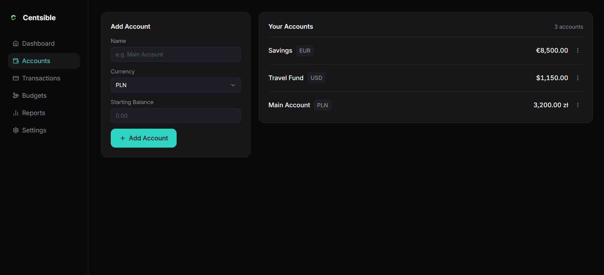
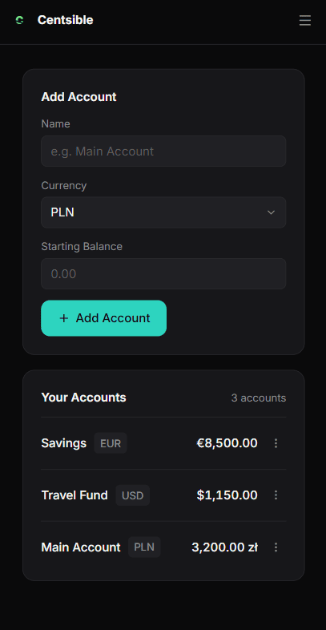

# Centsible

Budget tracker and planner with AI-powered analytics. Work in progress.

**[Live demo](https://centsible-budget.vercel.app/)** · [API repository](https://github.com/volha-codes/centsible-api)

 

## Status

You can sign up, sign in and sign out. Each user manages their own accounts: add, edit
and delete them, with duplicate-name validation, currency formatting, loading, error
and empty states and a responsive layout. Data is stored in PostgreSQL through the
API, so it survives a page refresh.

The Categories API is ready, but its screen is not built yet. Not built yet:
Categories screen, Transactions, Budgets, Reports, AI insights.

The demo runs on free hosting and sign-up has no email verification, so please don't
use a real password or real financial data. The API sleeps when idle, so the first
request after a pause can take up to a minute while it wakes up.

## Stack

React · TypeScript · Redux Toolkit · React Router · Tailwind CSS v4 · Vite

Tested with Vitest + React Testing Library. The backend lives in a separate repository:
NestJS · Prisma · PostgreSQL (Neon).

## How sign-in works

The API sets a signed token in an `httpOnly` cookie, so the app's JavaScript never
sees it. On load the app asks `GET /auth/me` who is signed in, protected routes wait
for the answer, and signing out clears the cookie and resets the stored data.

All API calls go through `/api`. In development Vite proxies it to the local backend,
and in production Vercel rewrites it to the API. That keeps the app and the API on one
origin, so the cookie is first-party and no CORS setup is needed.

## Getting started

Run the [API](https://github.com/volha-codes/centsible-api) on port 3000, then:

```bash
npm install
npm run dev
```

## Testing

```bash
npm run test        # watch mode
npm run test:run    # single run
```

Reducers are tested through the thunk lifecycle actions, and the Accounts screen is
tested with a mocked `fetch`: loading, error with retry, empty state, creating an
account and a double click sending a single request. The sign-in flow is not covered
by tests yet.

## Roadmap

- [x] Backend + persistence (NestJS, Prisma, PostgreSQL)
- [x] Authentication
- [ ] Categories screen
- [ ] Transactions
- [ ] Tests for the sign-in flow
- [ ] Budgets and Reports
- [ ] AI-powered insights
- [ ] React Native mobile app, sharing types and Redux slices with the web app
